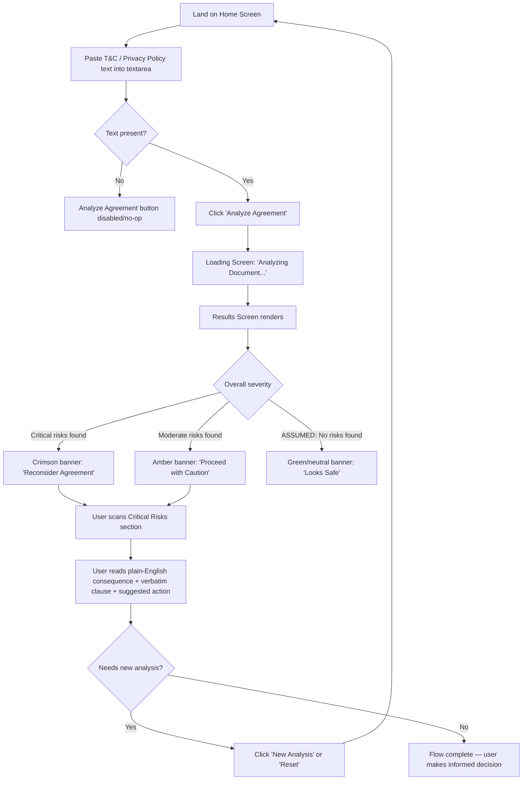

# ClauseGuard UI/UX Specification

> Generated per the BMAD-METHOD™ front-end spec template, reverse-engineered from existing hi-fi screens (`Clauseguard Homepage.png`, `Causeguard loading page.png`, `Clauseguard Results Page 1.png`, `Closeguard critical results.png`). Sections marked **[ASSUMED]** are inferred from visual evidence only and should be validated with the product owner / UX lead before being treated as settled decisions.

---

## 1. Introduction

This document defines the user experience goals, information architecture, user flows, and visual design specifications for **ClauseGuard**'s user interface. It serves as the foundation for front-end development, ensuring a cohesive and user-centered experience.

### 1.1 Overall UX Goals & Principles

**Target User Persona [ASSUMED]**
- Everyday consumer facing a wall of Terms & Conditions / Privacy Policy text before signing up for a service, trial, or subscription. Non-lawyer, time-pressured, wants a fast "should I be worried?" verdict rather than a legal education.

**Usability Goals**
- **Speed to insight:** a user should be able to paste text and receive a ranked risk summary in seconds, with no login or setup friction.
- **Scannability over completeness:** findings must be skimmable in under 30 seconds — bold consequence statements first, verbatim legal text second.
- **Confidence to act:** every flagged risk pairs a plain-English consequence with a concrete, specific suggested action (not generic advice).
- **Trust through transparency:** the product shows its work — the exact clause that triggered each flag is always visible.

**Design Principles**
1. **Plain English first, legalese second** — the UI leads with consequences, and treats the verbatim contract text as supporting evidence, not the headline.
2. **Severity is a color, not a paragraph** — risk level is communicated instantly via a coded banner color (amber = caution, crimson = critical) before the user reads a single word.
3. **One task per screen** — Home (input) → Loading (wait) → Results (decide) is a strictly linear flow with no branching navigation or parallel chrome.
4. **Calm, clinical neutrality in the UI; urgency lives only in the data** — the chrome (nav, cards, fonts) stays neutral gray/white so that severity colors and risk language carry 100% of the emotional signal.
5. **Reassure on privacy at the point of hesitation** — the exact moment a user is about to paste sensitive contract text is where the "secure client-side, no data stored" microcopy appears.

---

## 2. Information Architecture (IA)

### 2.1 Site/Screen Map

```
ClauseGuard (single-page application)
└── Home / Input Screen
      └── Analyzing (transient loading state)
            └── Results Screen
                  ├── Overall Recommendation Banner (severity-coded)
                  ├── Critical Risks section
                  ├── [ASSUMED] Moderate / Low Risk sections (collapsed or below fold)
                  └── "New Analysis" → returns to Home / Input Screen (state reset)
```

### 2.2 Navigation Structure

**Primary Navigation:** None in the traditional sense — this is a task-flow, not a multi-section app. The only persistent global elements are:
- Logo lockup (top-left, static, not a navigation link in current build)
- Build/version badge, e.g. `V1.0 HACKATHON BUILD` (top-right, informational only)
- `Reset` text link (top-right) — clears current session/input and returns to a blank Home screen
- `New Analysis` button (results screen only, inside the recommendation banner) — functionally a second reset affordance scoped to the results context

**[ASSUMED] Open question:** `Reset` (header) and `New Analysis` (banner) appear to be redundant exits from the Results screen. Recommend consolidating to a single, consistently-labeled action, or clearly differentiating their behavior (e.g., `Reset` clears input text; `New Analysis` keeps input but re-runs).

---

## 3. User Flows

### 3.1 Flow: Analyze an Agreement

**User Goal:** Understand whether a Terms & Conditions / Privacy Policy document contains risky terms before agreeing to it.

**Entry Points:** Direct link/bookmark to ClauseGuard home page.

**Success Criteria:** User reaches the Results screen and can identify the single highest-severity risk and its suggested mitigation within 30 seconds of the page loading.

#### Flow Diagram



**Edge Cases & Error Handling [ASSUMED — not visible in provided screens]:**
- Empty submission (no text pasted): CTA should be disabled or show inline validation; current screen shows `0 characters` counter which implies this state is tracked.
- Extremely long documents: no visible pagination/truncation strategy — needs definition.
- Analysis failure (e.g., unparseable text, network/API error): no error state screen currently designed — **gap to fill**.
- Zero risks found ("clean" document): no success/low-risk state currently designed — **gap to fill**. Recommend a calm green banner (e.g., "Looks Safe to Sign") to complete the severity palette (green → amber → crimson).

---

## 4. Wireframes & Mockups

**Primary Design Files:** Source screenshots in `Causeguard UI Screens/` (this folder). This spec documents what exists; it is not a Figma/Sketch file reference.

### Key Screen Layouts

#### Screen: Home / Input
**Purpose:** Capture raw T&C/Privacy Policy text and initiate analysis.

**Key Elements:**
- Header bar: logo lockup (icon + "ClauseGuard" wordmark), version badge pill, `Reset` link
- Two-line hero headline: neutral-dark first line ("Don't sign your life away."), brand-purple second line ("Know what's inside.") — establishes the color-as-emphasis pattern used throughout
- Supporting subcopy (2 lines, centered, gray, max-width constrained for readability)
- Bordered card containing:
  - Card header bar: uppercase label ("PASTE RAW T&C TEXT BELOW") + live character counter, right-aligned
  - Large multi-line textarea with placeholder copy
  - Card footer bar: privacy/trust microcopy with lock icon (left) + primary CTA button "Analyze Agreement →" (right)
- Below-the-fold: 3-column feature/benefit card row, each with a colored circular icon, title, and (implied) short description — partially cut off in source screenshot

**Interaction Notes:** Character counter updates live. CTA likely disabled at 0 characters [ASSUMED].

#### Screen: Loading / Analyzing
**Purpose:** Communicate processing state between submission and results.

**Key Elements:**
- Fully centered, vertically and horizontally, on a near-white background — all other chrome (header, nav) is removed, reinforcing that this is a focused transient state
- Circular icon container (search/magnifier glyph) with a thin ring — implies a pulse or spin animation
- Bold heading: "Analyzing Document…"
- Gray subcopy: "Extracting key clauses and mapping risk profiles."
- Three horizontal skeleton-loading bars of decreasing/varied width, simulating the shape of results about to appear

**Interaction Notes:** [ASSUMED] Skeleton bars likely pulse/shimmer; icon ring likely animates (spin or pulse) to indicate active processing rather than a frozen state.

#### Screen: Results — Caution (medium severity)
**Purpose:** Present overall verdict and ranked risk findings.

**Key Elements:**
- Header bar: identical to Home (logo, version badge, Reset)
- **Recommendation banner** (full-width, rounded, amber/orange fill):
  - Square icon badge (warning triangle, white-on-translucent)
  - Uppercase eyebrow: "OVERALL RECOMMENDATION"
  - Large bold verdict headline: "Proceed with Caution"
  - Supporting sentence explaining the verdict in plain language
  - Secondary/ghost button "New Analysis" (top-right of banner, semi-transparent on brand color)
- **Section header:** icon badge (flame, pink circle) + "Critical Risks" label + numeric count pill
- **Risk card(s)**, each containing:
  - Uppercase eyebrow label: "PLAIN ENGLISH CONSEQUENCE"
  - Bold statement of real-world impact (largest text in the card, near-black)
  - Severity badge, top-right, pill-shaped (e.g., "CRITICAL" in rose/pink)
  - Uppercase eyebrow: "VERBATIM CLAUSE"
  - Blockquote-styled box (light gray fill, italic text, oversized decorative quotation mark) containing the exact contract language
  - Callout box (light indigo fill) with lightbulb icon, uppercase eyebrow "SUGGESTED ACTION", and a specific, concrete recommendation in indigo text

#### Screen: Results — Reconsider (high/critical severity)
**Purpose:** Same template as above; demonstrates the severity-color-swap behavior of the recommendation banner.

**Key Elements (deltas from Caution screen only):**
- Banner fill changes from amber/orange to crimson/red
- Icon badge changes from warning-triangle to an octagonal stop/alert glyph (visually escalates the metaphor, not just the color)
- Verdict headline changes to "Reconsider Agreement"
- Count pill next to "Critical Risks" updates to reflect actual count (shown as 2 here vs. 1 in the Caution screen) — confirms the count is dynamic, not decorative
- All card-level styling (risk card, blockquote, suggested action) is identical to the Caution screen — **severity is communicated only at the banner + badge level, not by restyling every card**

---

## 5. Component Library / Design System

**Design System Approach:** No named/external design system is referenced in the screens (no visible Material, Ant, or shadcn tells beyond generic rounded-corner, soft-shadow conventions common to Tailwind-based UIs). Recommend formalizing the following as a lightweight internal component library.

### Core Components Observed

| Component | Variants Observed | Notes |
|---|---|---|
| **Logo lockup** | 1 (static) | Rounded-square indigo badge with white shield glyph + bold wordmark "ClauseGuard" |
| **Badge/Pill** | Version tag (neutral gray), Severity tag (critical/rose), Count tag (circular, pink) | All pill-shaped, uppercase or bold numeral, small type |
| **Button — Primary** | "Analyze Agreement →" | Solid indigo fill, white bold text, trailing arrow icon, rounded-lg, soft shadow |
| **Button — Ghost/Inverse** | "New Analysis" | Semi-transparent white fill on colored banner background, used for secondary actions in high-emphasis contexts |
| **Text Link** | "Reset" | Plain text, no underline, muted/dark gray |
| **Card — Input** | Home screen textarea container | Bordered container with distinct header bar, body, and footer bar (3-zone card) |
| **Card — Recommendation Banner** | Amber (caution), Crimson (critical), [ASSUMED] Green (safe) | Full-width, rounded-xl, icon badge + eyebrow + headline + body + action, color = severity |
| **Card — Risk Detail** | Critical (observed); [ASSUMED] High/Medium/Low variants not yet designed | White card, eyebrow-label pattern repeated 3x internally (consequence / verbatim / action) |
| **Blockquote — Verbatim Clause** | 1 | Light gray fill, italic serif-leaning body text [verify], oversized decorative quote glyph, used only for direct source text |
| **Callout — Suggested Action** | 1 (indigo) | Icon + eyebrow + recommendation text, distinguishes "what to do" from "what's wrong" |
| **Skeleton Loader** | 3-bar | Flat gray rounded rectangles, decreasing width, simulates upcoming card content |
| **Icon badge (circular)** | Red (alert/spot traps), Amber (speed/time), Green (translate/plain English) | Used in Home screen's 3-feature-card row |
| **Icon badge (square, rounded)** | Warning triangle (amber banner), Octagon stop (crimson banner) | Escalating alert iconography tied to severity |

---

## 6. Branding & Style Guide

### 6.1 Color Palette

| Color Role | Hex (approx.) | Usage |
|---|---|---|
| Brand Primary (Indigo) | `#4F46E5` – `#5B4FE5` | Logo badge, headline accent word, primary CTA button, link/action text in callouts |
| Primary Hover/Active [ASSUMED] | `#4338CA` | Button hover state |
| Critical / Danger | `#DC2626` – `#E11D48` (crimson-rose range) | "Reconsider Agreement" banner, CRITICAL severity badge |
| Warning / Caution | `#F59E0B` – `#F97316` (amber-orange range) | "Proceed with Caution" banner |
| Success / Safe [ASSUMED, not yet designed] | `#16A34A` – `#22C55E` (green range) | Recommend for a future "Looks Safe" banner, consistent w/ the green icon already used in the Home screen's "Plain English" feature card |
| Neutral — Background | `#FFFFFF` / `#F8F9FB` | Page background, card backgrounds |
| Neutral — Border/Divider | `#E5E7EB` | Card borders, header/footer bar dividers |
| Neutral — Text Primary | `#111827` (near-black) | Headlines, consequence statements |
| Neutral — Text Secondary | `#6B7280` (slate gray) | Subcopy, eyebrow labels, metadata |
| Callout Background (Indigo tint) | `#EEF2FF` | Suggested Action box fill |
| Quote Background (Gray tint) | `#F3F4F6` | Verbatim clause box fill |

**Design note:** the palette follows a clear semantic mapping — indigo = brand/action, amber = caution, crimson = danger. This 3(+1)-color severity system should be locked as a formal design token set (`color.severity.safe/caution/critical`) rather than re-derived per screen.

### 6.2 Typography

**Font Family [ASSUMED from rendering]:** A geometric/humanist sans-serif consistent with system-ui or Inter — recommend confirming the actual stack in code (likely Tailwind's default `font-sans`).

| Element | Size (approx.) | Weight | Notes |
|---|---|---|---|
| H1 / Hero Headline | 36–40px | Bold (700) | Two-line, two-color treatment on Home screen |
| H2 / Verdict Headline | 28–32px | Bold (700) | Inside recommendation banner |
| H3 / Card Statement | 18–20px | Bold (700) | "Plain English Consequence" text |
| Body | 15–16px | Regular (400) | Subcopy, verbatim quotes (italic variant) |
| Eyebrow / Label | 11–12px | Semibold (600), uppercase, letter-spaced | "OVERALL RECOMMENDATION", "VERBATIM CLAUSE", etc. — a strong recurring pattern throughout the UI |
| Button Text | 15–16px | Bold (700) | |
| Micro/Caption | 12–13px | Regular (400) | Character counter, privacy microcopy |

### 6.3 Iconography

- Style: outline/filled simple icons, likely from a library such as Lucide or Heroicons (shield, search, alert-triangle, octagon-alert, lightbulb, lock, languages/translate, zap).
- Usage pattern: icons are almost always housed in a colored circular or rounded-square badge rather than used bare — this containment pattern should be a reusable component (`IconBadge`), not ad hoc per instance.

### 6.4 Spacing & Shape

- Corner radius: generous rounding throughout (`rounded-lg`/`rounded-xl`/`rounded-2xl` equivalents) — cards, buttons, banners, and badges all share a soft, rounded visual language with no sharp corners anywhere observed.
- Shadows: soft, low-opacity drop shadows on the input card and buttons to lift them off the flat background.
- Container width: content appears centered with a max-width (likely ~900–1000px) with generous horizontal breathing room — consistent with a focused, non-dashboard task UI.

---

## 7. Accessibility Requirements

**[ASSUMED — not verifiable from static screenshots; the following are standard requirements to validate against the live build]**

**Compliance Target:** WCAG 2.1 AA (recommended default; confirm with stakeholders).

**Key Requirements to Verify:**
- **Color contrast:** the amber banner's white text on orange fill and the rose "CRITICAL" badge (pink text/bg combos) are at highest risk of failing 4.5:1 contrast — must be checked with a contrast tool against final hex values.
- **Color is not the only severity signal:** good — the design already pairs color with distinct iconography (triangle vs. octagon) and explicit text labels ("Proceed with Caution" / "Reconsider Agreement" / "CRITICAL" badge), which satisfies WCAG's "don't rely on color alone" guidance. Preserve this pattern for any future Safe/Low/Medium states.
- **Textarea labeling:** the "PASTE RAW T&C TEXT BELOW" header bar must be programmatically associated with the textarea (`<label>` or `aria-labelledby`), not just visually adjacent.
- **Live region for loading/results:** the transition from Loading → Results should use `aria-live="polite"` so screen reader users are notified when analysis completes, since there's no visible page navigation to anchor focus.
- **Focus management:** on reaching the Results screen, focus should move to the recommendation banner or a skip-link target, not remain on a now-gone "Analyze" button.
- **Keyboard access:** all interactive elements (Reset, New Analysis, Analyze Agreement) must be reachable and operable via keyboard with visible focus states (not shown in static screens).

---

## 8. Responsiveness Strategy

**[ASSUMED — screenshots show only a single desktop-width breakpoint (~1000–1050px)]**

| Breakpoint | Width | Adaptation Notes (recommended) |
|---|---|---|
| Mobile | <640px | Stack feature cards to 1 column; reduce hero headline to ~28px; recommendation banner should stack icon/headline/button vertically rather than horizontally |
| Tablet | 640–1024px | Feature card row likely goes to 2 columns; input card retains full layout |
| Desktop | >1024px | As designed in source screens |

**Recommendation:** no mobile/tablet screens currently exist for this flow — this is the most significant gap for a production-ready spec and should be prioritized before implementation, since legal-text pasting is plausible on mobile but the current textarea/card chrome is desktop-oriented.

---

## 9. Animation & Micro-interactions

**[ASSUMED based on visual cues — no motion was observable in static PNGs]**

- **Loading state:** circular ring around the search icon strongly implies a spin or pulse animation; skeleton bars typically shimmer left-to-right.
- **Banner color transition:** if severity can change without a full page reload (e.g., re-analysis), consider a smooth color-crossfade on the recommendation banner rather than an abrupt swap.
- **Button states:** primary CTA likely has hover (darken) and active (scale/press) states per standard convention — not visible in static capture.
- **Card entrance:** results cards could benefit from a staggered fade/slide-in as they replace skeleton placeholders, reinforcing the "extracting → populating" narrative already set up by the loading screen's skeleton bars.

---

## 10. Gaps & Open Questions for Product/UX Follow-up

1. **Missing severity state:** no "Low Risk / Looks Safe" results screen exists yet — needed to complete the 3-tier (or 4-tier) severity system implied by the color palette.
2. **Missing error/empty states:** no design for analysis failure, unparseable input, or empty-submission validation.
3. **Redundant reset affordances:** `Reset` (header) vs. `New Analysis` (banner) — clarify distinct behaviors or consolidate.
4. **No mobile/responsive layouts designed.**
5. **Feature card row on Home screen is cropped in the source screenshot** — only 3 icon badges and the start of a title ("Spot Traps") are visible; full card content (icon + title + description for all 3) should be captured/confirmed.
6. **Multiple-risk-category layout undefined:** screens only show the "Critical Risks" section; if Moderate/Low risk categories exist, their section header color, ordering, and default expand/collapse state need definition.
7. **Verbatim font treatment:** confirm whether the quoted clause text is meant to render in a serif/monospace face to visually distinguish "their words" from "our words," or if italic-sans is the final intended treatment.

---

## 11. Next Steps

1. Validate assumed sections (personas, accessibility target, responsive breakpoints, color hex values) with the product owner.
2. Export exact design tokens (hex values, spacing scale, font stack) directly from the live codebase/Figma if available, to replace the approximated values in Section 6.
3. Design the missing states identified in Section 10 (Safe/Low severity banner, error state, empty state, mobile layout).
4. Hand off to front-end development with this spec plus finalized token values.
